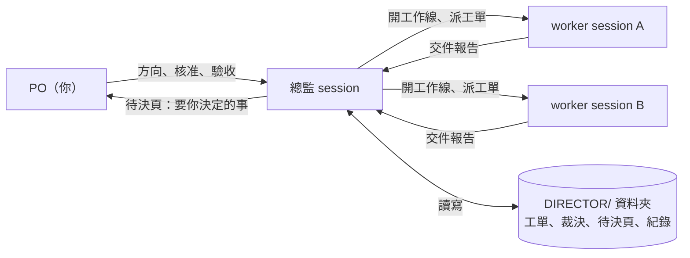
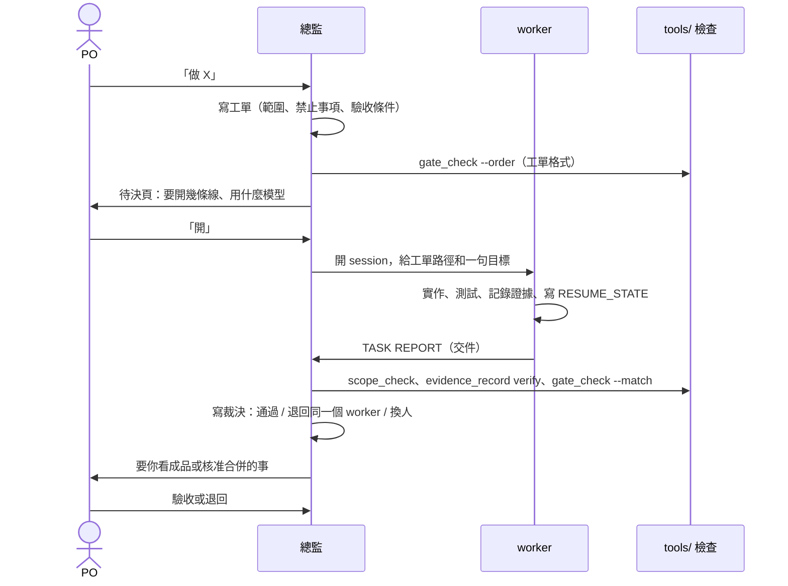

# DIRECTOR-WORK

讓一個 AI 當你的「專案經理」，替你管好其他幾個寫程式的 AI。你只要說要做什麼、回答選擇題、看成品。

## 這是什麼

用 Claude Code 同時開好幾個對話（session）寫程式，很快就會亂：誰在做什麼、做到哪、做得對不對，全靠你自己記、自己盯。

這套流程把其中一個 session 變成「總監」，由它替你派工、檢查、整理要你決定的事。可以把它想成一間小公司：

| 公司裡 | 在這套流程裡 | 做什麼 |
|---|---|---|
| 老闆 | **你（PO，專案擁有者）** | 決定做什麼、花不花錢、要不要公開，最後收貨 |
| 專案經理 | **總監**（一個 Claude session） | 把你的需求寫成工單、派給工程師、檢查交件、把要你決定的事整理成選擇題 |
| 工程師 | **worker**（其他 Claude session） | 照工單寫程式、測試、交件 |

它不是要安裝的軟體。內容是一組 Markdown 規則和範本，加上幾個只用 Python 標準函式庫的檢查工具。總監會自己讀完規則、在你的專案裡建好需要的檔案。

## 它解決什麼問題

| 沒有它時常見的狀況 | 這套流程怎麼處理 |
|---|---|
| AI 說「做好了」，打開卻不對 | 交件要附證據，工具檢查有沒有超出範圍、證據對不對得上；成品另外看，最後由你驗收 |
| 額度很快就用完 | 對話保持短：長對話自動壓縮，大量閱讀交給只回結論的小幫手（subagent）；`usage_mix.py` 每週量額度花在哪 |
| 額度用完、當機、重開機後，忘了做到哪 | 每個 session 把「做到哪、下一步」寫在檔案裡，回來照著接 |
| 幾個 session 互相踩到 | 每條工作線有自己的工單、分支和範圍 |
| 你得一直盯著 | 要你決定的事集中在一頁，每題附選項和建議 |

## 開始前要準備

- **Claude Code**：終端機版或 Claude Desktop 的 Code 分頁都可以，用你現有的 Claude 方案。不需要另外付費的服務。
- **一個用 git 管理的專案資料夾**。不是 git repo 時，總監會停下來問你。
- **Python 3.9 以上**：跑檢查工具用，只用標準函式庫，不用 `pip install`。

你不用先讀懂這套規則，總監會自己讀。

## 怎麼開始

1. 打開 Claude Code，資料夾選你的專案，開一個新 session，取名「總監」。
2. 把下面的啟動提示詞整段貼給它。
3. 它會先問你要用**一般模式**還是**小白模式**（見下一節），選一個。選小白模式的話，它在同一則回覆就開始問你想做什麼，不會先讓你等一長串建置。
4. 一般模式：等它建置。它會讀這個 repo 的文件，在專案旁邊建一個 `DIRECTOR/` 資料夾，在專案的 `CLAUDE.md` 最上方加一段說明（原內容不動）。小白模式：它先在專案旁邊（不動專案裡的檔案）寫最少的狀態檔，一邊跟你聊需求；完整建置等你確認要開工、要開第一位 AI 助手之前才做。兩種模式碰到推送、付費、刪除、帳號、會影響其他專案的事，都會先列出來問你，不會自己做。
5. 一般模式建好後它給你第一份回報，接著跟你聊需求：做給誰、要做出什麼、一定要有和絕對不要的。聊到能寫成一張「專案初衷卡」，你確認了它才開工。小白模式它會把卡和開工說明放在同一則，你一句「卡片對，請開一位 AI 助手做這一批」就是同時確認卡和同意開工；想改就直接說哪裡要改。
6. 做的途中要你選的（例如 A 風格或 B 風格），預設直接在聊天問你。它會先問你要不要把選擇題和圖片放在你自己的 Claude 私人頁面讓你點選；你說好而且工具可用才會放，不用就在聊天回答。

### 一般模式和小白模式

| | 一般模式 | 小白模式 |
|---|---|---|
| 適合 | 懂一點技術、想自己決定設定的人 | 只想說要做什麼、不想碰技術的人 |
| 會問你的 | 需求、風格，加上 plugin、工作線、設定這類技術問題 | 只問要做什麼、像什麼、好不好、可不可以 |
| 技術的事 | 你決定 | 總監照預設決定，記在初衷卡上讓你知道 |
| 安全的事（推送、公開、付費、刪除、帳號） | 先問你 | 一樣先問你，用白話 |
| 什麼時候開始聊需求 | 建置完成後 | 選完模式的同一輪 |

兩種模式都會先寫初衷卡，每張工單都對回初衷卡，所以不會做歪。細節見 `docs/12`。

### 啟動提示詞（可直接貼）

```text
你是這個專案的「總監」（Development Director），是我（PO）的代理人。
請使用這套流程：https://github.com/scottpuppylu/DIRECTOR-WORK

0. 先問我要用一般模式還是小白模式，我選了再開始。選小白模式時，同一輪就開始問我想做什麼；
   你可以先在專案旁邊（專案資料夾外）寫最少的狀態檔，不改專案裡的任何檔（BOOTSTRAP.md「小白快速路徑」）。
1. 依序讀 README.md → PURPOSE.md → BOOTSTRAP.md → docs/ 01 到 10（含 06b）和 12；在 Claude Desktop 上另讀 11。
2. 照 BOOTSTRAP.md 在本專案建置總監制：DIRECTOR/ 資料夾、CLAUDE.md 的總監段落、
   你自己的 RESUME_STATE、決策登記、PO 待決頁、壓縮門檻設定、記憶索引檢查。
   小白模式下，完整建置等談完需求、要開第一位 worker 前再做。
3. 會影響其他專案或使用者層設定的事（關 plugin 或 connector、帳號、付費、推送、
   公開發布、刪除），一律先列清單問我，不要自己做。
4. 建置完成後，照 BOOTSTRAP.md 第 13 步給我第一份回報，用繁體中文。
5. 開工前先跟我談需求，寫成專案初衷卡給我確認（BOOTSTRAP.md 第 14 步）；
   之後每張工單都要對到初衷卡。我可以用一句話同時確認卡和同意開工。
   要我看圖選的事，先問我要不要用選擇頁，我同意了才放；不同意就在聊天問。

本專案已有的規則（CLAUDE.md、我給過的指示）永遠優先於這套流程。
兩者衝突時照本專案的規則做，並在回報裡列出衝突點。
```

### 第一份回報長怎樣

內容固定六點（`BOOTSTRAP.md` 最後一步）。下面是示意，實際內容依你的專案而定：

```text
1. 結論：建置完成。
2. 建了什麼：DIRECTOR/ 放在專案上一層；CLAUDE.md 加了總監段落（已在本機 commit，未推送）；待決頁在 DIRECTOR/PO_PENDING.md。
3. 驗證結果：壓縮門檻設定 OK、探測數字相符；記憶索引大小在門檻內。沒驗證的寫 NOT_VERIFIED。
4. 和本專案規則的衝突：無。
5. 要你決定：OD-01 git 身分、OD-02 第一條工作線的編制。
6. 下一步：你回覆後，寫第一張工單。
```

## 用起來長怎樣

### 誰跟誰說話

你只跟總監說話。總監和 worker 之間靠檔案交接，訊息只在交件、卡住、要決定時才發。



### 一件事從交辦到驗收



### 你實際看到的

你不用盯 worker。總監會把要你決定的事集中在 `DIRECTOR/PO_PENDING.md`，每一項都有選項和建議：

```text
ID: OD-05
STATUS: open
QUESTION: 接受新的存檔格式嗎？
OPTIONS: A 接受 / B 要改（說明哪裡）
RECOMMENDED: A：只加版本號和 id，舊檔自動遷移並留備份
ANSWER:
```

在聊天裡回「OD-05：A」就好。

### 專案裡多了什麼

節錄，完整清單見 `BOOTSTRAP.md` 第 3 步：

```text
工作區/
├── 你的專案/                 git repo
│   └── CLAUDE.md             最上方加一段「總監」說明，原內容不動
└── DIRECTOR/                 總監的所有狀態；預設放 repo 外，所有 worktree 共用
    ├── RESUME_STATE.md       總監做到哪、下一步
    ├── PO_PENDING.md         要你決定的事
    ├── DECISION_REGISTER.md  決定過的事和理由
    ├── ACTIVE_WORKSTREAMS.md 現在有哪些工作線
    ├── DIRECTOR_LOG.md       一行一事的紀錄
    ├── orders/               工單
    ├── reviews/              裁決
    └── tools/                檢查工具（從本 repo 複製）
```

## 你平常要做的事

- **說要做什麼**：用平常的話，例如「幫我加一個匯出 CSV 的功能」。
- **回答待決頁**：「OD-05：A」，或直接在檔案的 `ANSWER:` 填。
- **看成品**：驗收，或說哪裡不對（「按鈕要在右邊」）。
- **核准要你核准的事**：推送（push）、合併到 main、公開發布、刪除或覆寫、付費、帳號，以及這個專案以外的事。

其他技術細節（怎麼寫、交件過不過、要不要退回重做）由總監自己決定，事後記在 `DIRECTOR/` 的紀錄裡，你隨時可以翻。

## 常見問題

**要花錢嗎？**
不用另外付費。它用你現有 Claude 方案的額度，而省額度正是設計重點之一：模型每次回應都要重讀整段對話，所以對話越短越省。檢查工具只用 Python 標準函式庫。

**它會亂改我的檔案嗎？**
總監只管你任命它的那個專案。推送、合併到 main、刪除或覆寫、付費、帳號都要你先同意。你專案原有的規則（`CLAUDE.md`、你給過的指示）永遠優先；兩邊衝突時照你的規則做，並在回報裡告訴你。

**中斷了怎麼辦？**
每個 session 都把「做到哪、下一步」寫在自己的 `RESUME_STATE.md`。回到總監的 session 說「繼續」，它會先讀待決頁、紀錄和工作線狀態，再接著做。額度用完、當機、換新 session 都一樣，不靠對話記憶。

**小改動也要走全套嗎？**
不用。工單分三級，越小越輕：

| 等級 | 用在 | 多做什麼 |
|---|---|---|
| Direct | 純查詢、文件，沒有風險 | 不做規格審查 |
| Standard | 一般開發，可以回退 | 規格審查選用 |
| Strict | 核心邏輯、資料格式、存檔、對外介面、跨分支整合、發布 | 派工前一定先做規格審查 |

**一定要開很多個 session 嗎？**
不用。從一條 worker 開始就可以，要開幾條由你在待決頁決定。

**測試都通過了，為什麼還要我看？**
測試通過不等於成品對。總監會另外看成品，但最後收不收貨由你決定。

## 名詞小抄

| 名詞 | 意思 |
|---|---|
| PO | Product Owner，專案擁有者，就是你 |
| 總監 | 當你代理人的 Claude session |
| worker | 照工單做事的 Claude session |
| session | 一個獨立的 Claude 對話 |
| 工單 | 給 worker 的任務單：範圍、禁止事項、驗收條件 |
| gate | 工單裡的檢查點；做到這裡就交件，等總監裁決 |
| 裁決 | 總監看完交件後的決定：通過、退回同一個 worker、換人，或請你授權 |
| 待決頁 | `DIRECTOR/PO_PENDING.md`，要你決定的事 |
| RESUME_STATE | 每個 session 的「做到哪、下一步」，中斷後靠它接著做 |
| 額度 | Claude 方案的用量上限 |
| subagent | session 臨時叫出來做單一工作（例如大量閱讀）的小幫手，做完只回結論 |

## 檔案地圖

以下給想深入的人。「每輪必讀」是總監每次恢復或換新 session 時要讀的；「需要時才讀」只在做那件事時讀。檔案寫得短，讀它本身就省額度。

| 檔案 | 內容 | 何時讀 |
|---|---|---|
| `README.md` | 本檔 | 第一次 |
| `PURPOSE.md` | 初衷、目的、不能破壞的核心、改規則前的檢查；只有 PO 能改 | 第一次；改規則、工具、範本前 |
| `BOOTSTRAP.md` | 新總監第一輪的逐步建置清單 | 第一次 |
| `docs/01_roles_authority.md` | 角色、權限、總監可自行決定與必須送 PO 的事 | **每輪必讀** |
| `docs/02_work_orders_gates.md` | 工單、gate、TASK REPORT、裁決、測試排程與預算 | 派工、裁決時 |
| `docs/03_communication.md` | 什麼時候發訊息、PO 待決頁、PO 訊息不漏讀 | **每輪必讀** |
| `docs/04_quota_efficiency.md` | 額度成本模型、省額度的槓桿、怎麼量 | 設定時、每週複查時 |
| `docs/05_models_effort.md` | 模型與思考程度（effort）怎麼選 | 開新工作線時 |
| `docs/06_resume_lossless.md` | RESUME_STATE、總監自身的恢復 | **每輪必讀**（恢復時） |
| `docs/06b_on_demand_procedures.md` | 中斷後恢復程序、機制重建、額度重置喚醒、刪檔前比對 | 恢復、建機制、刪檔時 |
| `docs/07_quality_gates.md` | 工程與成品分開、盲審包、常識閘門、修正上限 | 審查成品時 |
| `docs/08_safety_rules.md` | 要 PO 核准的事、git 與檔案的禁止事項 | **每輪必讀** |
| `docs/09_memory.md` | 記憶索引的大小與整理 | 每週、超過門檻時 |
| `docs/10_lessons_learned.md` | 原專案的教訓；每輪必讀規則的理由 | 第一次；寫新規則前；判斷必讀規則的邊界情況時 |
| `docs/11_claude_desktop.md` | 在 Claude Desktop 上開 worker、傳訊息、讀額度和上下文視窗用哪個工具 | 在 Desktop 上建置與操作時 |
| `docs/12_chat_to_product.md` | 一般 / 小白模式、專案初衷卡、選擇頁、不做歪的檢查 | 建置時；談需求、開選擇題、寫工單時 |
| `templates/` | CLAUDE.md 段落、工單、報告、RESUME_STATE、測試申請、決策登記、裁決、待決頁、專案初衷卡、選擇頁、規格審查提示、DIRECTOR/ 其他檔案骨架 | 建置與派工時 |
| `tools/` | 設定寫入、免費探測、用量統計和用量結構、記憶大小檢查；交件檢查（格式、驗收對照、範圍、證據紀錄、報告對動作紀錄）、追溯表、修正輪數、每線狀態腳本 | 見 `tools/README.md` |
| `director_work.example.json` | 工具設定範例 | 建置時 |
| `VERSION`、`CHANGELOG.md` | 版本號、各版改了什麼、升級怎麼遷移 | 建置時記版本；升級時 |

## 防護是安全帶，不是剎車（1.3.1）

- **使用者在對話裡核准了，就執行。** 推送、合併、打 tag、刪除這類事先問 PO（`docs/08`）；PO 說可以，AI 直接做，不拆設定、不請 PO 自己跑。
- **已核准的事不重問。** 同一件事 PO 已經說可以，就不再開確認卡、不換個說法再問一次。核准仍是一次一件，不推廣到別的動作。
- **阻擋只留給明確 opt-in。** `tools/hook_guard.py` 預設 `--mode remind`：標出的指令照跑，附一行提醒；`--mode ask` 交給使用者當場決定；只有 `--mode block` 才 exit 2 擋下。不要預設把 block 裝到工作線，工作線的 AI 會因此不敢動手（`docs/10` L-045）。例外：讀機密（G50–G52：`.env`、`~/.ssh`、token）和暫停旗標在每個模式都擋，核准也不放行。
- 引號裡的字和 here-document 的內容是資料，不是指令，不會被標出（L-044）。
- 1.3.0 以前裝的 hook 是擋下模式；改成提醒：`setup_project_settings.py --hooks --guard-mode remind --apply`（`CHANGELOG.md` 1.3.1 的遷移）。

## 執行期防護（1.1.0）：哪些真的擋、哪些只是提醒

`tools/hook_guard.py`、`audit_log.py`、`pause_ctl.py`、`doctor.py` 和 `templates/settings.runtime-guard.json` 是一組防手滑的機制，**不是安全邊界**，不要當成和 VM、容器或平台級 agent 一樣安全。裝好後在 worker 的資料夾跑 `tools/doctor.py`，它會逐項標 ENFORCED / CONFIGURED_NOT_VERIFIED / NOT_ENFORCED / MISSING（見 `tools/README.md`）。

| 項目 | 等級 | 理由 |
|---|---|---|
| hook 標出的指令 | 預設 **只提醒**（`--mode remind`，照跑）；`--mode ask` **擋到有人點頭**；`--mode block` **擋**（exit 2 ＋ `permissions.deny`），但不是安全邊界 | Claude Code 執行工具前一定先跑 hook；但指令文字可以繞：`eval`、先寫腳本再跑、變數拼字、編碼 |
| ask 規則（block 模式下只有總監的 profile 有） | **擋到有人點頭** | `permissions.ask` 在 bypass 模式也會問；hook 回 ask 在 bypass 模式下的行為 NOT_VERIFIED |
| 暫停開關 | **擋 Claude 發起的新動作** | 已經在跑的程序不會停，要另外依 PID 停整棵程序樹 |
| 自動暫停（worker 600 秒內 5 次 deny，只在 block 模式） | **擋之後的新動作** | 只算 hook 的 deny；總監不開 |
| 動作紀錄 | **可驗證、不能防竄改** | 能寫檔的人可以整條重寫；有錨點才抓得到；不含使用者自己打的 `!` 指令和 hook 以外的行為 |
| 機密讀取 | **擋常見寫法** | 清單以外的檔名、間接讀法擋不到 |
| 機密遮罩 | **擋常見格式** | 沒見過的 token 格式遮不到 |
| 獨立審查 `--review` | **只會多擋**；NOT_VERIFIED | 預設關。selftest 只用假的 claude 測過，沒有用真的 `claude -p` 取樣；模型判斷不穩定，不能當主閘門 |
| Monitor 的指令 | 要 claude ≥ 2.1.314 才經過 hook；NOT_VERIFIED | 欄位格式照官方文件假設，沒有在真的 Monitor 上取樣。doctor 依版本報 |
| worktree 隔離 | **檢查** | doctor 報告，不強制 |
| OS 層隔離 | 原生 Windows：**沒有**（NOT_ENFORCED） | 指令和 Claude Code 同權限跑，能動到整台機器的檔案；也沒有網路出口管制。doctor 在原生 Windows 上永遠報這一項，所以一定 exit 1 |
| 容器裡的 worker（`tools/container/`） | **擋**：根目錄和 DIRECTOR 唯讀、沒有 capability、只能連白名單名稱的 443、只解析白名單名稱（DNS）；`--clone` 時 worker 只有自己的 clone（K1） | 實測 35 案繞路探測都擋下；1.2.0 DNS 容器實測 20 案、K1 容器實測 9 案、doctor 容器實測 8 案。doctor `--probe --director` 在容器裡查六項 |
| 容器 worker 的 `.git`（K1） | `--clone`：**擋**。原 repo 不掛進容器，它的 ref、tag、objects 容器裡碰不到；worker 不能 push | 總監用 `worker_clone.sh collect` 只收那一條分支，放到 `refs/dw-workers/<名稱>/<分支>`；bundle 先在隔離 repo 過 `index-pack --strict` 和 `fsck --strict`。舊的 `--git-common` 保留一版：印 WARN、doctor 報 NOT_ENFORCED（K1 shared .git），2.0 拿掉 |
| 容器的 DNS | **擋**：容器裡的 `dns_allow.py` 只回答白名單名稱的 A / AAAA，其他回 NXDOMAIN 或 REFUSED；直接問別的 DNS 伺服器被拒；沒有關閉開關 | 剩下的路見下表「容器的 DNS」 |

刻意沒做、或依使用者決定不做的：

| 落差 | 現況 |
|---|---|
| WSL2 sandbox 範本 | 拿掉。要在 WSL2 裡另裝 bubblewrap 和 socat 才能實測，不裝就永遠是 NOT_VERIFIED；不提供一份沒跑過的範本。隔離改走容器 |
| 工作目錄外寫入 | 依使用者決定不啟用 `blockWritesOutsideWorkingDirectories`；範本不放，hook_guard 不做替代檢查，doctor 不查 |
| gh token scope | token scope 維持 repo/read:org/gist/workflow，依使用者決定不縮小；防護改靠擋讀取 token 的指令和容器內不放 token |
| 子程序憑證清洗 | `CLAUDE_CODE_SUBPROCESS_ENV_SCRUB=1` 依官方設計**保留** `GITHUB_TOKEN`、`GH_TOKEN`、proxy 帳密和 `GIT_CONFIG_*`；原生 Windows 上的行為未證實，`doctor.py --probe` 只列名稱 |
| OTEL 的 `safety_event` | 2.1.312 起官方不再送，DW 不依賴 |
| 容器隔離 | 只有用 `tools/container/run_worker.sh` 開的 worker 有；Desktop 開的 session 不在容器裡 |
| 容器裡的 `.git`（舊的 `--git-common`） | 整個可寫（`hooks/`、`config`、`worktrees/` 除外）：worker 能動別的 branch 的 ref 和 tag。1.2.0 保留一版，doctor 報 NOT_ENFORCED，2.0 拿掉；改用 `--clone` |
| 容器的 DNS | 白名單名稱的查詢仍會送到上游：上游看得到查了哪個名稱、A 還是 AAAA、什麼時候查。查詢的時間點可以當成很慢的隱密通道。`*.` 開頭的名稱只解析、不開 443 |
| 容器的 IP | 443 的 IP 只在開容器時解析一次；`api.anthropic.com` 中途換 IP，連線就會失敗，要重開容器 |
| hook 可以被關掉 | 任一設定層 `disableAllHooks: true` 就全部失效；DW 不能、也不該鎖使用者的設定，doctor 會報 NOT_ENFORCED |
| 憑證代理 | 沒有。憑證仍在環境變數和檔案裡，DW 只擋「讀」的常見寫法 |
| 紀錄的外部見證 | 沒有。只有雜湊鏈加上從 commit 取的錨點 |

## 已知限制

- 派工後沒有 ACK 的閒置監看（`NO_ACK` 狀態）：規則和三個測試案例的規格寫在 `docs/06b`，`tools/` 這版沒有監看工具，要自己做或等之後的版本。
- 執行期防護的落差見上一節。
- 其他沒做的項目見 `CHANGELOG.md` 各版的「沒做」。

## 原則

- **PO 的專案特有規則永遠優先。** 這套流程是預設值，不是更高層的規則。
- 這套流程只管總監被任命的那個專案。其他專案、使用者層設定、全域工具，都要 PO 決定。
- **不能偏離初衷。** `PURPOSE.md` 是所有規則的上位依據，只有 PO 能改。改規則前先過它的五題檢查，答案寫進 `CHANGELOG.md`。
- 規則都是「規則 → 為什麼」。改規則時，把「為什麼」一起改。

本流程源自一個 3D 遊戲專案的實戰（多個 session 同時開發，運作數週）。文中的數字是那個專案量到的案例，換了方案、版本或專案，數字可能不同，請自己量（`tools/`）。

## 授權

MIT，見 `LICENSE`。
